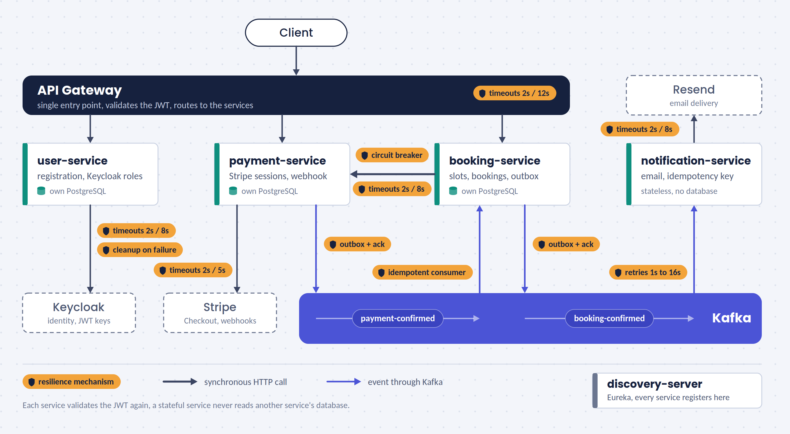

# 🎓 LinguaHub

**A language-tutoring marketplace built from event-driven microservices on Spring Boot 4.**
Teachers publish lesson slots, students book and pay, an email confirms it, and the system stays consistent when things fail.


### 🎬 [Watch the full flow in 3 minutes](https://www.loom.com/share/0bb3232f44864059bb7b4f2e5cd26077)

## 💡 Why LinguaHub

I wanted a project where I could use what I already know about microservices, push it further, and learn the parts I
had only read about by building them for real: events that must not get lost, payments that must not be charged
twice, services that must survive each other's failures.

I chose a domain close to my life: **education and learning languages**. Finding a teacher, booking a lesson and paying
for it is a problem everyone understands, and a good excuse for hard engineering underneath.

A monolith would be enough at this scale. Splitting it into services was a deliberate choice for learning, and the
limitations below say honestly where that choice has a cost.

## ✨ Highlights

- 🧩 **Gateway, Eureka and 4 domain services**, each stateful service with its own database
- 💳 **Real payments**: Stripe Checkout, signed webhooks, one payment per booking
- 📬 **Reliable events without distributed transactions**: transactional outbox + idempotent consumers
- 🛡️ **Resilience by design**: timeout budget, circuit breaker on the synchronous call, classified retries
- 🗄️ **Invariants live in the database**: no overbooking, no duplicate bookings, schema versioned with Liquibase
- 🔐 **Security on every hop**: JWT at the gateway and in each service, Keycloak roles, ownership checks
- 🧪 **150+ tests** with real PostgreSQL and Kafka (Testcontainers), run by CI on every push

## 🏗️ Architecture



The amber badges mark where resilience lives. Every call that leaves a service has timeouts, booking → payment
also has a circuit breaker, and events travel through an outbox. Each stateful service has its own PostgreSQL database.

| Service | Port | Job |
|---|---|---|
| `api-gateway` | 8080 | Single entry point, JWT validation, routing |
| `user-service` | 8081 | Registration: Keycloak user, realm role and profile |
| `booking-service` | 8082 | Slots, bookings, atomic place reservation |
| `payment-service` | 8083 | Stripe sessions, webhook, payment state |
| `notification-service` | 8084 | Consumes `booking-confirmed`, sends the email |
| `discovery-server` | 8761 | Eureka service registry |
| `keycloak` | 8180 | Identity provider, the realm is imported on first start |

> 💡 **Why Kafka *and* Feign?** The checkout link must be in the HTTP response, so that one call is synchronous and
> protected. Everything after the payment is asynchronous: nobody waits for it and it must survive restarts.

## 🛡️ Resilience

| Where | Mechanism | Behaviour on failure |
|---|---|---|
| booking → payment | **Circuit breaker** + timeouts (2s / 8s). Opens at 50% failures over 10 calls, stays open 15s. 4xx do not count | `503`, transaction rolled back, place released |
| payment → Stripe | Timeouts (2s / 5s), no SDK retries | Fails fast, the breaker upstream sees it |
| gateway → services | Timeouts (2s / 12s) | The client gets an error, not a hanging request |
| user → Keycloak | Timeouts + compensation | A half-created Keycloak user is deleted |
| notification → Resend | Timeouts + idempotency key + error classification | Final `4xx` is never retried, `408 409 429 5xx` are |
| Kafka consumers | `ErrorHandlingDeserializer`, 5 retries with backoff 1s to 16s | A poison message is one log line, never a stuck consumer |
| Outbox relays | Wait for the broker's acknowledgement (10s) | The row stays unsent and is retried |

**Timeout budget.** Every layer gives up before the one above it, so nothing keeps running orphaned:

```
gateway 12s  >  booking → payment 8s  >  payment → Stripe 2s + 5s
```

**Two deliberate choices**

- **The Resilience4j time limiter is off.** It defaults to 1 second and runs the call on another thread, which loses the
  security context (the user's token would not reach `payment-service`). Feign's own timeouts do the timing instead.
- **No retry on the payment call.** It runs inside the booking transaction, which holds a lock on the slot, and a retry
  would hold the lock longer. It would be safe (payments are idempotent), but it is a conscious trade-off.

## 🔒 Consistency and security

| Risk | Answer |
|---|---|
| State saved, event lost | **Transactional outbox**, the relay publishes only after the broker acknowledges |
| Event delivered twice | Idempotent consumers: confirm only from `PENDING`, fulfilling a paid payment again is a no-op |
| Two emails | Resend `Idempotency-Key` = `booking-confirmed/{id}` |
| Double booking, overbooking | Atomic `UPDATE … WHERE booked_count < capacity`, a `CHECK`, a partial unique index per student and slot |
| Two payments per booking | Unique `booking_id`, a lost race returns `409` |
| Someone else's data | Ownership checks (`403`), roles `STUDENT` and `TEACHER` from Keycloak enforced with `@PreAuthorize` |
| Internal endpoint exposed | `single-lesson` has no gateway route, the webhook verifies Stripe's signature |

Delivery is **at-least-once** and every consumer is idempotent, so the *effect* happens exactly once.

## 🧰 Tech stack

**Java 21** · **Spring Boot 4.1** (MVC, Data JPA, Security) · **Spring Cloud** (Gateway, Eureka, OpenFeign) ·
**Resilience4j** · **Apache Kafka** · **PostgreSQL** + **Liquibase** · **Keycloak** · **Stripe** · **Resend** ·
**Testcontainers** · **Docker Compose** · **GitHub Actions**

## 🚀 Getting started

**Prerequisites:** Docker with Compose, a Stripe account in test mode and a Resend API key. JDK 21 and Maven are
only needed to run the tests. `jq` and the Stripe CLI are optional.

### Run

```bash
git clone https://github.com/OWNER/REPO.git && cd REPO
cp .env.example .env     # Stripe secret and webhook secret, Resend key, Keycloak admin client secret
docker compose up -d --build
```

| What | URL |
|---|---|
| API (gateway) | http://localhost:8080 |
| Eureka dashboard | http://localhost:8761 |
| Keycloak | http://localhost:8180 |

On the first start Keycloak imports the realm, including the `STUDENT` and `TEACHER` roles.

> 🙋 **No Stripe or Resend account?** The video above shows the whole flow, including the email and the circuit breaker.

### Try the whole flow

```bash
# 1. Register a teacher and a student (use your Resend account email for the student, see the note below)
curl -X POST localhost:8080/api/v1/users/register -H 'Content-Type: application/json' \
  -d '{"username":"teacher1","email":"teacher1@example.com","password":"password123","firstName":"Anna","lastName":"Nowak","role":"TEACHER"}'
curl -X POST localhost:8080/api/v1/users/register -H 'Content-Type: application/json' \
  -d '{"username":"student1","email":"YOUR_RESEND_EMAIL","password":"password123","firstName":"Jan","lastName":"Kowalski","role":"STUDENT"}'

# 2. Get a token for each (the role comes from Keycloak)
get_token() { curl -s -X POST localhost:8180/realms/linguahub/protocol/openid-connect/token \
  -d grant_type=password -d client_id=linguahub-app -d username="$1" -d password=password123 | jq -r .access_token; }
TEACHER=$(get_token teacher1)
STUDENT=$(get_token student1)

# 3. The teacher creates a slot (the same call with $STUDENT returns 403)
curl -X POST localhost:8080/api/v1/slots -H "Authorization: Bearer $TEACHER" -H 'Content-Type: application/json' \
  -d '{"startTime":"2030-01-15T10:00:00","endTime":"2030-01-15T11:00:00","capacity":1}'

# 4. The student books it and gets a Stripe Checkout link in sessionUrl
curl -X POST localhost:8080/api/v1/bookings -H "Authorization: Bearer $STUDENT" -H 'Content-Type: application/json' \
  -d '{"slotId":1}'
```

Open the returned `sessionUrl` and pay with the Stripe test card `4242 4242 4242 4242` (any future date, any CVC). The
redirect settles the payment. To receive webhooks locally too, run
`stripe listen --forward-to localhost:8080/api/v1/payments/webhook` and put the printed signing secret in `.env`.

Watch the event chain end to end:

```bash
docker compose logs -f payment-service booking-service notification-service
```

> 📧 Resend's test sender only delivers to the address of the Resend account owner, so register the student with it.

### See the circuit breaker open

```bash
docker compose stop payment-service    # book a few times: 503 first, then instant 503
docker compose start payment-service   # bookings work again after about 15 seconds
```

## 📚 API

| Method | Path | Who |
|---|---|---|
| `POST` | `/api/v1/users/register` | public |
| `POST` `DELETE` | `/api/v1/slots`, `/api/v1/slots/{id}` | TEACHER |
| `GET` | `/api/v1/slots`, `/api/v1/slots/{id}` | STUDENT, TEACHER |
| `POST` `GET` | `/api/v1/bookings`, `/api/v1/bookings/{id}` | STUDENT |
| `GET` | `/api/v1/payments` | any signed-in user |
| `GET` `POST` | `/api/v1/payments/success`, `/cancel`, `/webhook` | public, the webhook is signed |

Errors use RFC 9457 `ProblemDetail`: `409` conflict, `403` role or ownership, `503` payment unavailable.

## 🧪 Testing and CI

```bash
mvn clean verify              # needs Docker
bash scripts/test-summary.sh  # totals per module
```

Unit tests, controller slices (roles, `403`), repository slices on real PostgreSQL, Kafka integration tests
(poison messages, duplicates, retries) and smoke tests that boot every service against real PostgreSQL and Kafka,
**run the Liquibase migrations and validate the schema against the entities**. GitHub Actions runs everything on every push.

## ⚠️ Known limitations

Conscious cut-offs, not oversights:

- ⏳ Unpaid bookings **do not expire** yet, an abandoned checkout keeps its place
- 🔒 The booking transaction holds a slot lock during the payment call (bounded by timeouts), and a rollback after the
  payment was created leaves an orphaned payment record
- 📭 **No dead-letter topic**: an event that exhausts its retries is logged with its full payload for manual replay
- 🧹 Outbox rows are never cleaned up and the relay assumes a single instance
- 💸 No automatic refunds, a fixed lesson price, times without time zones
- ✉️ Email works in Resend's test mode, production needs a verified domain
- 🔌 The circuit breaker covers the booking → payment call only, the gateway has timeouts but no breaker or rate limiting
- 📈 No metrics or tracing yet (no Actuator)

## 🗺️ Roadmap

**Hardening first**

- [ ] Dead-letter topic with replay
- [ ] Actuator, metrics and tracing
- [ ] Expire unpaid bookings and release their places

**Then new features**

- [ ] 🎥 Lesson meeting link in the confirmation email, starting with Google Meet
- [ ] 💬 A built-in lesson room with video and chat, so lessons happen inside LinguaHub